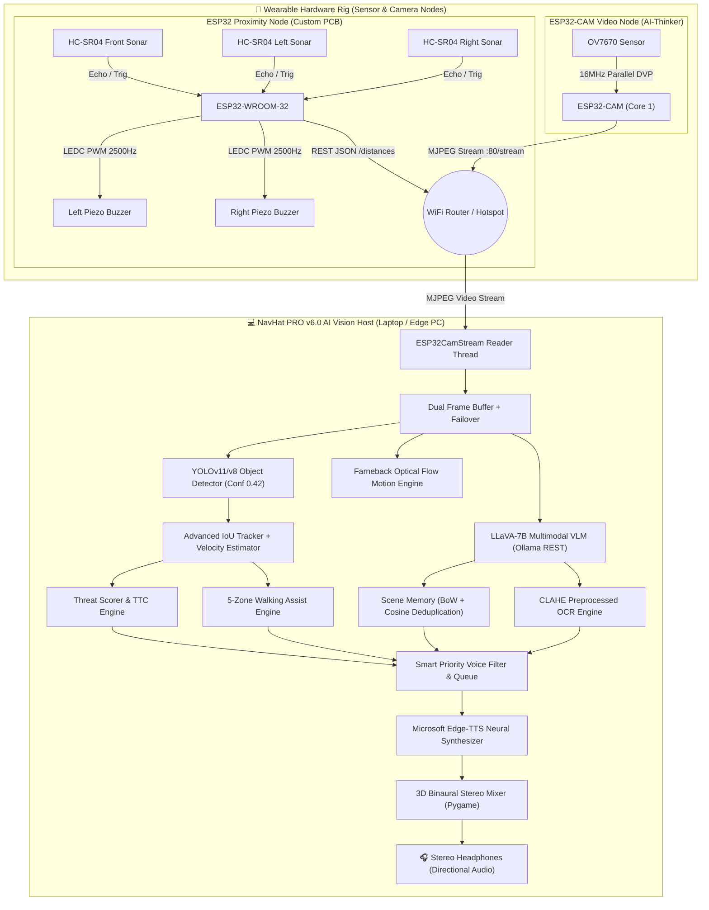
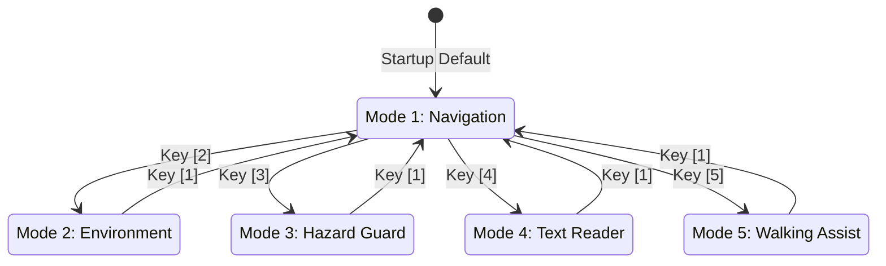

<div align="center">

# 🧢 NavHat PRO
### **Next-Generation Cyber-Physical Blind Navigation & Edge AI Vision System**

[](https://www.espressif.com/)
[](https://github.com/ultralytics/ultralytics)
[-4169E1?style=for-the-badge&logo=ollama&logoColor=white)](https://ollama.com/)
[](https://github.com/rany2/edge-tts)
[](https://www.autodesk.com/products/fusion-360/)
[](LICENSE)

<br/>

**NavHat PRO** is an open-source, multi-node wearable cyber-physical assistive device engineered to give visually impaired users real-time spatial awareness, obstacle warning, and contextual intelligence.

[⚡ 5-Minute Quickstart](#-5-minute-quickstart-guide) • [📐 System Architecture](#-system-architecture) • [🛠 Hardware & BOM](#-hardware-architecture--pcb-design) • [🧠 5 AI Modes](#-5-intelligent-operating-modes) • [🔧 Firmware Guide](#-firmware-guide) • [📚 Full Documentation](#-documentation-index)

---

### 🌟 Hardware Gallery

| 🛰️ 3D PCB Assembly Render | 🔌 Circuit Schematic Diagram |
| :---: | :---: |
|  |  |
| **Top PCB Trace Layout (2-Layer)** | **Custom Hardware Headwear / Rig** |
|  | <i>Tri-directional ultrasonic sonar + dual piezo haptics + ESP32-CAM stream</i> |

</div>

---

## 📚 Documentation Index

| Guide / Manual | Description | Link |
| :--- | :--- | :---: |
| **🏛️ Deep Architecture** | Distributed multi-node topology, FreeRTOS core pinning & latency budgets | [Read Architecture](docs/ARCHITECTURE.md) |
| **🧠 5 AI Modes Manual** | Mathematical threat formulation, Bag-of-Words cosine deduplication & 5-zone logic | [Read AI Modes](docs/AI_MODES_DEEP_DIVE.md) |
| **📡 REST API Reference** | OpenAPI / JSON specifications for `/distances`, `/status`, `/stream`, `/debug` | [Read API Specs](docs/API_REFERENCE.md) |
| **📋 Bill of Materials** | Full component listing with supplier part numbers and estimated unit costs | [Read BOM](hardware/BOM.md) |
| **🔌 Wiring & Schematics** | Step-by-step breadboard & soldering guide with $1\text{k}\Omega/2\text{k}\Omega$ voltage dividers | [Read Wiring Guide](hardware/WIRING_GUIDE.md) |
| **🏭 Gerber & PCB Fab** | PCB ordering guidelines for JLCPCB / PCBWay (2-layer, $1\text{oz}$ Cu, ENIG) | [Read Gerber Guide](hardware/GERBER_INSTRUCTIONS.md) |
| **🖨️ 3D Enclosure Specs** | 3D printed cap brim mount, camera gimbal angles, and PETG print settings | [Read 3D Print Specs](hardware/CASE_3D_PRINTING.md) |
| **⚡ Firmware Architecture** | Embedded FreeRTOS tasks, DMA capture, and calibration utilities | [Read Firmware Guide](firmware/README.md) |
| **👁️ Vision System Guide** | YOLO tracking, Edge-TTS audio mixer, and diagnostic test scripts | [Read Vision Guide](vision_system/README.md) |

---

## 📐 System Architecture



---

## 🛠 Hardware Architecture & PCB Design

### Power Chain & Voltage Protection

```text
[ LiPo Battery (3.7V) ] ──► [ TP4056 USB Charger ] ──► [ 5V Step-Up Boost ]
                                                              │
                     ┌────────────────────────────────────────┴───────────────────┐
                     ▼                                                            ▼
              [ 5V Sensor Rail ]                                           [ LD1117-3.3V LDO ]
              (HC-SR04 VCC × 3)                                                   │
                     │                                                            ▼
        Echo Out (5V Logic) ──► [ 1kΩ + 2kΩ Divider ] ──► [ ESP32 GPIO (3.3V Safe) ]
```

1. **5V $\rightarrow$ 3.3V Signal Conditioning**: HC-SR04 ultrasonic echo pins emit $5\text{V}$ pulses. A resistive voltage divider ($1\text{ k}\Omega$ in series, $2\text{ k}\Omega$ to GND) steps down the return signal to $3.33\text{V}$, preventing overvoltage latch-up on ESP32 GPIOs:
   $$V_{\text{GPIO}} = V_{\text{ECHO}} \times \frac{R_2}{R_1 + R_2} = 5.0\text{V} \times \frac{2000}{1000 + 2000} = 3.33\text{V}$$

2. **LDO Regulation & Filtering**: The onboard **LD1117-3.3V** converts the boosted 5V rail to a clean 3.3V rail for ESP32 VDD3P3 pins with dual $10\mu\text{F}$ solid capacitors to suppress high-frequency ripple.

---

### Bill of Materials Summary

| Component | Designator | Description / Value | Qty | Cost |
| :--- | :--- | :--- | :---: | :---: |
| **ESP32 Dev Module** | U1 | Dual-core 240MHz, 4MB Flash | 1 | $3.50 |
| **ESP32-CAM Board** | CAM1 | AI-Thinker Module + OV7670 / OV2640 | 1 | $4.80 |
| **Ultrasonic Sensors** | US_F, US_L, US_R | HC-SR04 Ultrasonic Sonar Modules | 3 | $2.70 |
| **Piezo Transducers** | BUZZ_L, BUZZ_R | Passive Piezo Buzzers ($2\text{kHz}-4\text{kHz}$) | 2 | $0.80 |
| **Linear Regulator** | VR1 | LD1117 SOT-223 3.3V LDO | 1 | $0.35 |
| **Passives & Diodes** | R1-R6, C1-C2 | Dividers ($1\text{k}\Omega/2\text{k}\Omega$) & $10\mu\text{F}$ caps | 8 | $0.28 |
| **Power System** | PWR, BAT | TP4056 + 5V Boost + 3.7V LiPo Cell | 3 | $4.90 |

👉 *For full component part numbers and supplier links, see [hardware/BOM.md](hardware/BOM.md).*

---

## 🔧 Firmware Guide

### 1. ESP32 Sensor Node Firmware
Located at [`firmware/sensor_node/sensor_node.ino`](firmware/sensor_node/sensor_node.ino).

```text
  0 cm               30 cm                              70 cm
  ├────────────────────┼──────────────────────────────────┼───────────────────► Distance
     CRITICAL ZONE                 PROXIMITY ZONE                  SAFE ZONE
     Continuous Tone            Dynamic Beep (100-600ms)         Silent (0 Hz)
     @ 2500 Hz                  @ 1800 Hz
```

* **Median Ghost Echo Rejection**: Samples 3 rapid pulses with $500\mu\text{s}$ blanking delays to discard acoustic multipath noise:
  $$d_{\text{filtered}} = \text{median}(d_1, d_2, d_3)$$
* **Non-Blocking Buzzer Intervals**:
  - **$\text{Distance} < 30\text{ cm}$ (CRITICAL)**: Continuous $2500\text{ Hz}$ tone fired on both buzzers simultaneously.
  - **$30\text{ cm} \le \text{Distance} < 70\text{ cm}$ (CLOSE)**: Dynamic pulse beeping ($1800\text{ Hz}$) scaling from $100\text{ ms}$ (at $30\text{ cm}$) to $600\text{ ms}$ (at $70\text{ cm}$).
  - **$\text{Distance} \ge 70\text{ cm}$ (CLEAR)**: Silent.
* **REST HTTP Endpoints**:
  - `GET /distances` $\rightarrow$ JSON `{"front": 42.1, "left": 120.0, "right": 84.5}` (CORS enabled).
  - `GET /status` $\rightarrow$ `NAVHAT_SENSOR_OK`.
  - mDNS: `http://navhat-sensor.local`

---

### 2. ESP32-CAM Video Node (v18)
Located at [`firmware/camera_node/camera_node.ino`](firmware/camera_node/camera_node.ino).

* **Direct Grayscale Acquisition (`PIXFORMAT_GRAYSCALE`)**: Direct OV7670 grayscale capture for maximum throughput.
* **Software JPEG Compression (`fmt2jpg` q=80)**: Encodes frames on FreeRTOS Core 1 with 3 framebuffer queues (`fb_count=3`).
* **Resolution Switching**:
  - **QQVGA ($160\times 120$)**: Default ultra-low latency stream ($\approx 30\text{ FPS}$).
  - **QVGA ($320\times 240$)**: High-detail mode toggled dynamically via `/res?v=qvga`.
* **Embedded Cyber-HUD Web Dashboard**: Hosts a live browser UI on port 80 with telemetry stats, CSS contrast/brightness sliders, and night presets.

---

## 🧠 NavHat PRO v6.0 AI Vision Host System

Located at [`vision_system/navhat_vision.py`](vision_system/navhat_vision.py).

```text
┌─ NavHat PRO v6.0 ──────────────────────────────────────────┐
│  Mode     : NAV       FPS :  29.8  Objects:   3            │
│  Camera   : ESP32-CAM @ 10.154.74.40                       │
│  Motion   : [████████░░░░░░░░░░░░] 38.2% HIGH              │
│  Threat   :   78/100  Audio: edge-tts neural               │
│  Objects  : 2 people  1 car                                │
│  Status   : Watch out! Impact in 2.1s. Car very close...   │
│  Keys     : [1]Nav [2]Env [3]Haz [4]OCR [5]Walk            │
│             [F]Flow [S]Snap [Q]Quit                        │
└─────────────────────────────────────────────────────────────┘
```

---

### 🕹️ 5 Intelligent Operating Modes



#### `[1]` Navigation Mode (Default)
Runs YOLOv11/v8 + IoU multi-object tracking + velocity vectors. Groups objects by category and speaks directional spatial audio (e.g., *"two people nearby on your left, one car coming toward you"*).

#### `[2]` Environment Mode
Captures a full-scene snapshot every 12 seconds and queries local **LLaVA-7B** to deliver a concise, natural description in under 15 words. Includes Bag-of-Words Cosine similarity deduplication to prevent repetitive chatter when stationary.

#### `[3]` Hazard Guard Mode
Strict hazard detection prioritizing high-risk obstacles (vehicles, steps, knives, construction). Triggers an urgent, interruptible tone warning if the calculated threat score exceeds $35/100$.

#### `[4]` Text Reader / OCR Mode
Applies CLAHE contrast normalization and prompts LLaVA vision to transcribe visible text, signs, room numbers, labels, or notices out loud.

#### `[5]` Walking Assist Mode
Segments the camera field into **5 vertical corridors** (*far left, left, center, right, far right*). Analyzes obstacle density and speaks actionable navigation guidance (e.g., *"Move right. Path clearer on your right"* or *"Stop. Obstacle directly ahead"*).

---

### 📊 Threat Scoring & Time-to-Collision (TTC)

Every detected object is evaluated in real time using the following threat formula:

$$\text{Threat} = W_{\text{base}} + (A_f \times 120) + (15 \text{ if approaching}) + \min\left(\frac{v}{50}, 20\right) + (25 \text{ if } \text{TTC} < 3.5\text{s})$$

Where:
* $W_{\text{base}}$: Base hazard weight (e.g., `car` = 25, `knife` = 30, `bus` = 25, `person` = 10, `chair` = 5).
* $A_f$: Area Fraction = $\frac{\text{Bounding Box Area}}{\text{Total Frame Area}}$.
* $v = \sqrt{v_x^2 + v_y^2}$: Tracked centroid velocity in pixels/second.
* $\text{TTC}$ (Time-to-Collision): Derived from the rate of expansion of the bounding box area:
  $$\text{TTC} = \frac{A_t}{\overline{\Delta A}} \times \Delta t$$

---

### 🎧 3D Stereo Spatial Audio & Emotion Tones

Audio cues are generated using **Microsoft Edge Neural TTS** (`en-IN-NeerjaNeural`) and mapped across 5 binaural stereo channels using Pygame's dual-channel volume controller:

| Spatial Zone | Horizontal FOV | Left Ear Volume ($V_L$) | Right Ear Volume ($V_R$) | Perceived Position |
| :--- | :---: | :---: | :---: | :--- |
| **Far Left** | $0\% - 20\%$ | **1.0** | **0.1** | Hard Left |
| **Left** | $20\% - 40\%$ | **1.0** | **0.4** | Soft Left |
| **Center** | $40\% - 60\%$ | **1.0** | **1.0** | Centered |
| **Right** | $60\% - 80\%$ | **0.4** | **1.0** | Soft Right |
| **Far Right** | $80\% - 100\%$ | **0.1** | **1.0** | Hard Right |

#### Emotion Tone Profiles
* **Calm Tone** ($\text{Threat} < 35$): Speech Rate `+60%`, Pitch `+0Hz`, Volume `+0%`.
* **Alert Tone** ($35 \le \text{Threat} < 60$): Speech Rate `+80%`, Pitch `+5Hz`, Volume `+10%`.
* **Urgent Tone** ($\text{Threat} \ge 60$): Speech Rate `+100%`, Pitch `+15Hz`, Volume `+20%` (Instantly interrupts ongoing speech).

---

## 📁 Repository Structure

```text
NavHat-PCB-Design-main/
│
├── 📜 README.md                             # Master documentation (This file)
├── 📜 LICENSE                               # MIT License
├── 📜 requirements.txt                      # Top-level Python dependencies
├── 📜 .gitignore                            # Git tracking filter
│
├── 📁 docs/                                 # Architectural & Technical Manuals
│   ├── 📄 ARCHITECTURE.md                   # Multi-node distributed system architecture
│   ├── 📄 AI_MODES_DEEP_DIVE.md             # Detailed breakdown of all 5 operating modes
│   ├── 📄 API_REFERENCE.md                  # Complete REST API specifications
│   └── 📄 CONTRIBUTING.md                   # Open-source contributing guidelines
│
├── 📁 firmware/                             # Microcontroller Source Code
│   ├── 📄 README.md                         # Firmware overview & FreeRTOS guide
│   ├── 📁 sensor_node/                      # ESP32 Ultrasonic + Buzzer Node
│   │   ├── 📄 sensor_node.ino               # Main sensor firmware sketch
│   │   └── 📄 config.h                      # Hardware pins & threshold settings
│   ├── 📁 camera_node/                      # ESP32-CAM (OV7670) Streamer
│   │   ├── 📄 camera_node.ino               # Main camera firmware sketch (v18)
│   │   └── 📄 config.h                      # Camera pinout & buffer settings
│   └── 📁 calibration/                      # Hardware Calibration Utilities
│       └── 📄 sensor_calibration.ino        # Serial Plotter calibration sketch
│
├── 📁 vision_system/                        # Python AI Vision & Spatial Audio System
│   ├── 📄 README.md                         # Vision system guide & benchmark instructions
│   ├── 📄 navhat_vision.py                  # Main Python application
│   ├── 📄 config.json                       # Central system configuration
│   ├── 📄 model.cfg                         # YOLO model config (yolo11n.pt / yolov8n.pt)
│   ├── 📄 requirements.txt                  # Python dependencies
│   ├── 📄 setup.bat                         # Automated Windows installer (venv + pip)
│   ├── 📄 run.bat                           # One-click Windows launcher
│   ├── 📄 test_camera.py                    # Standalone camera stream benchmark
│   ├── 📄 test_audio.py                     # Standalone 3D binaural spatial audio test
│   └── 📄 test_llava.py                     # Standalone Ollama / LLaVA benchmark
│
├── 📁 hardware/                             # Hardware Design Files & Renderings
│   ├── 📄 BOM.md                            # Comprehensive Bill of Materials
│   ├── 📄 WIRING_GUIDE.md                   # Step-by-step assembly & wiring instructions
│   ├── 📄 GERBER_INSTRUCTIONS.md            # PCB manufacturing guide for JLCPCB
│   ├── 📄 CASE_3D_PRINTING.md               # 3D printed mount & enclosure specifications
│   └── 📁 pcb/                              # PCB Assets
│       ├── 🖼 schematic.png                 # Fusion 360 circuit schematic
│       ├── 🖼 pcb_layout_top.png            # 2-layer PCB trace layout
│       ├── 🖼 pcb_3d_render.png             # 3D PCB component render
│       └── 📄 README.md                     # Hardware design notes
│
├── 📁 tests/                                # Automated Unit Tests
│   ├── 📄 test_tracker.py                   # Tests for IoU and TTC calculations
│   └── 📄 test_threat_scorer.py             # Tests for threat calculation formula
│
└── 📁 .vscode/                              # IDE Workspace Configurations
    ├── 📄 settings.json                     # Linter & diagnostic rules
    └── 📄 c_cpp_properties.json             # ESP32 C++ include paths
```

---

## ⚡ 5-Minute Quickstart Guide

Anyone can build, flash, and run NavHat PRO by following these 3 simple steps:

### Step 1: Flash the Microcontrollers

#### A. Flash ESP32 Sensor Node
1. Open [`firmware/sensor_node/sensor_node.ino`](firmware/sensor_node/sensor_node.ino) in **Arduino IDE**.
2. Select **Board**: `ESP32 Dev Module`.
3. Set your WiFi `ssid` and `password` on lines 20-21.
4. Click **Upload** and copy the IP address printed in Serial Monitor (`115200` baud).

#### B. Flash ESP32-CAM Video Node
1. Open [`firmware/camera_node/camera_node.ino`](firmware/camera_node/camera_node.ino) in **Arduino IDE**.
2. Select **Board**: `AI Thinker ESP32-CAM`.
3. Set **Partition Scheme**: `Huge APP (3MB No OTA/1MB SPIFFS)`.
4. Connect `GPIO 0` to `GND`, press **RESET**, click **Upload**, then disconnect `GPIO 0` and reset.
5. Copy the Camera IP address from Serial Monitor.

---

### Step 2: Install Local AI (Ollama)
1. Download and install [Ollama](https://ollama.com/).
2. Open your terminal and pull the LLaVA vision model:
   ```bash
   ollama pull llava:7b
   ```
3. Keep Ollama running in the background.

---

### Step 3: Run the Vision System

#### Option A: Windows (1-Click Automated)
1. Edit `esp32_ip` in [`vision_system/config.json`](vision_system/config.json) (or line 47 in [`vision_system/navhat_vision.py`](vision_system/navhat_vision.py)) with your ESP32-CAM IP:
   ```json
   "esp32_ip": "192.168.1.105"
   ```
2. Double-click [`vision_system/setup.bat`](vision_system/setup.bat) to install virtualenv and dependencies.
3. Double-click [`vision_system/run.bat`](vision_system/run.bat) to launch the HUD!

#### Option B: Manual Setup (Terminal)
```bash
# Navigate to vision system directory
cd vision_system

# Create and activate Python virtual environment
python -m venv venv
source venv/bin/activate       # Linux/macOS
# or: venv\Scripts\activate    # Windows

# Install required packages
pip install -r requirements.txt

# (Optional) Run hardware diagnostics
python test_camera.py          # Benchmark camera stream
python test_audio.py           # Test 3D spatial headphones
python test_llava.py           # Test local LLaVA-7B AI

# Run NavHat PRO
python navhat_vision.py
```

---

## 🧪 Running Automated Unit Tests

Verify tracking and threat scoring algorithms locally with Python's unittest suite:

```bash
python -m unittest discover tests
```

---

## ⌨️ Keyboard Hotkeys & Controls

| Key | Mode / Action | Description |
| :---: | :--- | :--- |
| `1` | **Navigation Mode** | Real-time YOLOv11 tracking + grouped spatial audio. |
| `2` | **Environment Mode** | LLaVA multimodal environmental description. |
| `3` | **Hazard Guard Mode** | High-threat obstacle detection and collision alerts. |
| `4` | **Text Reader Mode** | CLAHE OCR reader for signs, labels, and text. |
| `5` | **Walking Assist Mode** | 5-zone corridor path guidance for walking. |
| `F` | **Toggle Optical Flow** | Toggles Farneback motion flow vector grid. |
| `S` | **Save Snapshot** | Saves annotated image + metadata JSON to `navhat_snapshots/`. |
| `Q` | **Quit Application** | Gracefully shuts down camera stream, audio queue, and window. |

---

## ❓ Troubleshooting & FAQ

### 1. Camera stream fails to connect
* **Cause**: Host computer and ESP32-CAM are on different WiFi subnets.
* **Fix**: Ensure both devices are connected to the same 2.4GHz WiFi hotspot. Test connection by visiting `http://<ESP32_IP>/` in your browser.

### 2. Audio is silent or slow
* **Cause**: Internet connection required for high-definition Microsoft Edge Neural TTS.
* **Fix**: The system automatically falls back to offline `pyttsx3` speech if offline. Connect to WiFi for full neural voice features.

### 3. ESP32-CAM brownout / reboot loop
* **Cause**: Insufficient 5V current during peak WiFi transmit bursts.
* **Fix**: Power the ESP32-CAM with an external 5V 2A power supply or high-discharge LiPo cell.

---

## 📜 License & Acknowledgments

This project is licensed under the **MIT License** — see the [LICENSE](LICENSE) file for details.

Developed with:
* [Ultralytics YOLOv11](https://github.com/ultralytics/ultralytics)
* [Ollama & LLaVA](https://ollama.com/)
* [Microsoft Edge-TTS](https://github.com/rany2/edge-tts)
* [Espressif Systems](https://www.espressif.com/)
