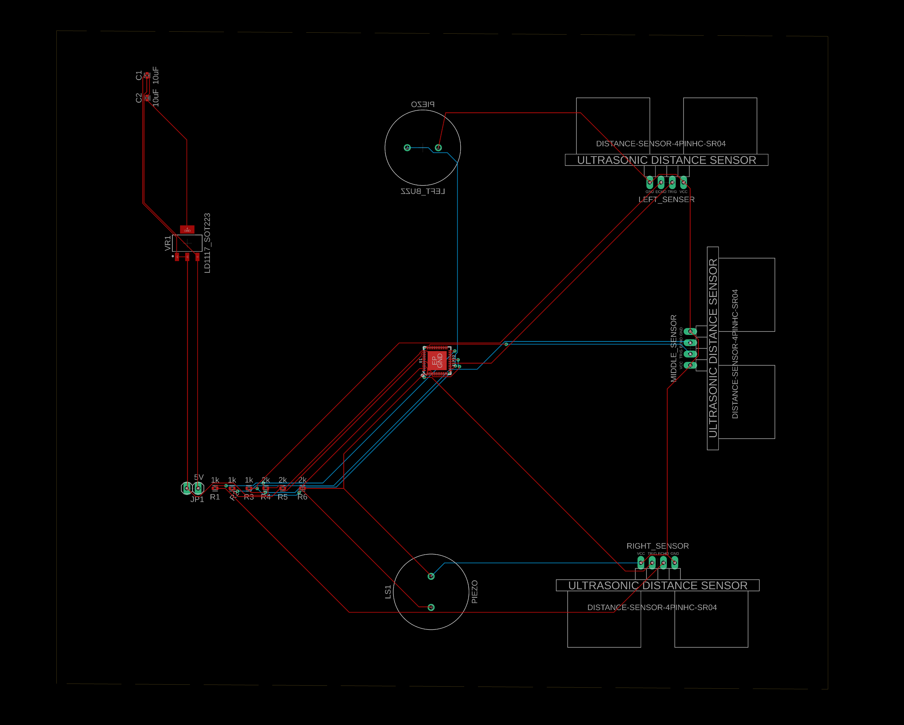
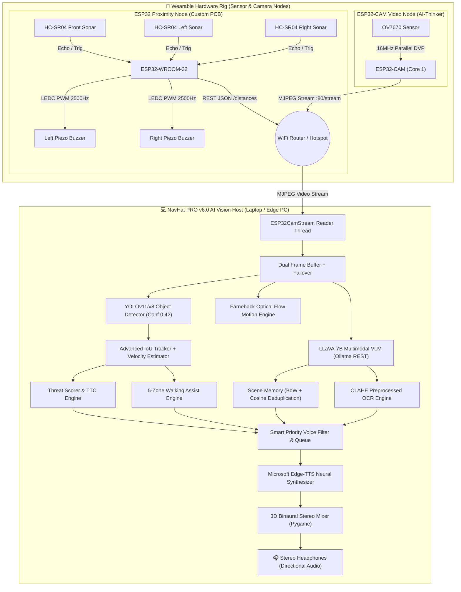
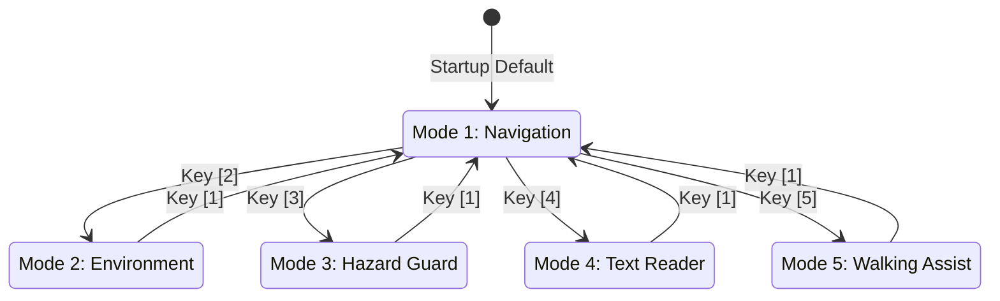

<div align="center">

# 🧢 NavHat PRO
### **Next-Generation Cyber-Physical Blind Navigation & Edge AI Vision System**

[](https://www.espressif.com/)
[](https://github.com/ultralytics/ultralytics)
[-4169E1?style=for-the-badge&logo=ollama&logoColor=white)](https://ollama.com/)
[](https://github.com/rany2/edge-tts)
[](https://www.autodesk.com/products/fusion-360/)
[](LICENSE)

<br/>

**NavHat PRO** is an open-source, multi-node wearable cyber-physical assistive device engineered to give visually impaired users real-time spatial awareness, obstacle warning, and contextual intelligence.

[⚡ Quickstart (5 Mins)](#-5-minute-quickstart-guide) • [📐 System Architecture](#-system-architecture) • [🛠 Hardware & PCB](#-hardware-architecture--pcb-design) • [🧠 5 AI Modes](#-5-intelligent-operating-modes) • [🔧 Firmware Guide](#-firmware-guide)

---

### 🌟 Hardware Gallery

| 🛰️ 3D PCB Assembly Render | 🔌 Schematic Diagram |
| :---: | :---: |
|  |  |
| **Top PCB Trace Layout (2-Layer)** | **Custom Hardware Headwear / Rig** |
|  | <i>Tri-directional ultrasonic sonar + dual piezo haptics + ESP32-CAM stream</i> |

</div>

---

## 📑 Table of Contents
- [🌟 System Overview](#-system-overview)
- [📐 System Architecture](#-system-architecture)
- [🛠 Hardware Architecture & PCB Design](#-hardware-architecture--pcb-design)
  - [Power Chain & Voltage Protection](#power-chain--voltage-protection)
  - [Bill of Materials (BOM)](#bill-of-materials-bom)
  - [Microcontroller Pinout Mapping](#microcontroller-pinout-mapping)
- [🔧 Firmware Guide](#-firmware-guide)
  - [1. ESP32 Sensor Node](#1-esp32-sensor-node-firmware)
  - [2. ESP32-CAM Video Node (v18)](#2-esp32-cam-video-node-v18)
- [🧠 NavHat PRO v6.0 AI Vision Host System](#-navhat-pro-v60-ai-vision-host-system)
  - [5 Intelligent Operating Modes](#-5-intelligent-operating-modes)
  - [Threat Scoring & Time-to-Collision Formula](#-threat-scoring--time-to-collision-ttc)
  - [3D Stereo Spatial Audio & Emotion Profiles](#-3d-stereo-spatial-audio--emotion-tones)
- [📁 Repository Structure](#-repository-structure)
- [⚡ 5-Minute Quickstart Guide](#-5-minute-quickstart-guide)
- [⌨️ Keyboard Hotkeys & Controls](#-keyboard-hotkeys--controls)
- [❓ Troubleshooting & FAQ](#-troubleshooting--faq)

---

## 🌟 System Overview

Traditional mobility canes only detect physical hazards at ground level directly in front of the user. **NavHat PRO** solves this with a **dual-layer cyber-physical architecture**:

1. **Hardware Layer (Ultra-Low Latency Proximity Guard)**:
   - Custom ESP32 PCB with **3× HC-SR04 ultrasonic rangefinders** covering a $180^\circ$ forward/lateral arc.
   - Dual **piezo buzzers** providing directional pitch and frequency-modulated haptic audio warnings in $<10\text{ ms}$.
   - Hardware level-shifters and dedicated LDO regulator ensuring clean power and signal integrity.

2. **Edge AI Vision Layer (Cognitive Context & Guidance)**:
   - Wireless **ESP32-CAM video node** streaming low-latency grayscale/JPEG frames over WiFi.
   - Host Python AI engine running **YOLOv11** real-time object tracking, **Farneback optical flow**, and **LLaVA-7B multimodal VLM**.
   - **Microsoft Edge Neural TTS** delivering 3D binaural stereo audio panned directly to the direction of obstacles.

---

## 📐 System Architecture



---

## 🛠 Hardware Architecture & PCB Design

### Power Chain & Voltage Protection

```text
[ LiPo Battery (3.7V) ] ──► [ TP4056 USB Charger ] ──► [ 5V Step-Up Boost ]
                                                              │
                     ┌────────────────────────────────────────┴───────────────────┐
                     ▼                                                            ▼
              [ 5V Sensor Rail ]                                           [ LD1117-3.3V LDO ]
              (HC-SR04 VCC × 3)                                                   │
                     │                                                            ▼
        Echo Out (5V Logic) ──► [ 1kΩ + 2kΩ Divider ] ──► [ ESP32 GPIO (3.3V Safe) ]
```

1. **5V $\rightarrow$ 3.3V Signal Conditioning**: HC-SR04 ultrasonic echo pins emit $5\text{V}$ pulses. A resistive voltage divider ($1\text{ k}\Omega$ in series, $2\text{ k}\Omega$ to GND) steps down the return signal to $3.33\text{V}$, preventing overvoltage latch-up on ESP32 GPIOs:
   $$V_{\text{GPIO}} = V_{\text{ECHO}} \times \frac{R_2}{R_1 + R_2} = 5.0\text{V} \times \frac{2000}{1000 + 2000} = 3.33\text{V}$$

2. **LDO Regulation & Filtering**: The onboard **LD1117-3.3V** converts the boosted 5V rail to a clean 3.3V rail for ESP32 VDD3P3 pins with dual $10\mu\text{F}$ solid capacitors to suppress high-frequency ripple.

---

### Bill of Materials (BOM)

| Component | Designator | Description / Value | Qty |
| :--- | :--- | :--- | :---: |
| **Microcontroller 1** | U1 | ESP32 Dev Module (ESP-WROOM-32) | 1 |
| **Microcontroller 2** | CAM1 | AI-Thinker ESP32-CAM + OV7670 / OV2640 Module | 1 |
| **Ultrasonic Sensors** | US_F, US_L, US_R | HC-SR04 Ultrasonic Distance Sensors | 3 |
| **Piezo Transducers** | BUZZ_L, BUZZ_R | Passive Piezo Buzzers ($2\text{ kHz} - 4\text{ kHz}$) | 2 |
| **Voltage Regulator** | VR1 | LD1117 SOT-223 3.3V Low-Dropout Regulator | 1 |
| **Resistors (Divider)** | R1, R2, R3 | $1\text{ k}\Omega \pm 1\%$ 0805 SMD / Through-hole | 3 |
| **Resistors (Divider)** | R4, R5, R6 | $2\text{ k}\Omega \pm 1\%$ 0805 SMD / Through-hole | 3 |
| **Capacitors** | C1, C2 | $10\mu\text{F}$ 16V Ceramic / Tantalum Capacitors | 2 |
| **Power Management** | PWR | TP4056 LiPo Charger + 5V Boost Converter | 1 |
| **Battery** | BAT | 3.7V 18650 or 1200mAh LiPo Cell | 1 |

---

### Microcontroller Pinout Mapping

#### ESP32 Sensor Node Pinout
| ESP32 Pin | Connected Device | Function | Signal Voltage |
| :--- | :--- | :--- | :---: |
| **GPIO 13** | HC-SR04 Front | Trigger Pulse | 3.3V |
| **GPIO 18** | HC-SR04 Front | Echo Return (via $1\text{k}\Omega/2\text{k}\Omega$ Divider) | 3.3V conditioned |
| **GPIO 14** | HC-SR04 Left | Trigger Pulse | 3.3V |
| **GPIO 33** | HC-SR04 Left | Echo Return (via $1\text{k}\Omega/2\text{k}\Omega$ Divider) | 3.3V conditioned |
| **GPIO 19** | HC-SR04 Right | Trigger Pulse | 3.3V |
| **GPIO 23** | HC-SR04 Right | Echo Return (via $1\text{k}\Omega/2\text{k}\Omega$ Divider) | 3.3V conditioned |
| **GPIO 25** | Left Piezo Buzzer | LEDC PWM Tone Generation | 3.3V PWM |
| **GPIO 4** | Right Piezo Buzzer | LEDC PWM Tone Generation | 3.3V PWM |

#### ESP32-CAM Node Pinout
| Function | GPIO Pin | Function | GPIO Pin |
| :--- | :---: | :--- | :---: |
| **Camera PWDN** | GPIO 32 | **Camera Y2 (D0)** | GPIO 5 |
| **Camera XCLK** | GPIO 0 (16MHz) | **Camera Y3 (D1)** | GPIO 18 |
| **Camera PCLK** | GPIO 22 | **Camera Y4 (D2)** | GPIO 19 |
| **Camera VSYNC**| GPIO 25 | **Camera Y5 (D3)** | GPIO 21 |
| **Camera HREF** | GPIO 23 | **Camera Y6 (D4)** | GPIO 36 |
| **Camera SIOD** | GPIO 26 | **Camera Y7 (D5)** | GPIO 39 |
| **Camera SIOC** | GPIO 27 | **Camera Y8 (D6)** | GPIO 34 / Y9: GPIO 35 |

---

## 🔧 Firmware Guide

### 1. ESP32 Sensor Node Firmware
Located at [`firmware/sensor_node/sensor_node.ino`](file:///c:/Users/krish/Downloads/NavHat-PCB-Design-main/firmware/sensor_node/sensor_node.ino).

```text
  0 cm               30 cm                              70 cm
  ├────────────────────┼──────────────────────────────────┼───────────────────► Distance
     CRITICAL ZONE                 PROXIMITY ZONE                  SAFE ZONE
     Continuous Tone            Dynamic Beep (100-600ms)         Silent (0 Hz)
     @ 2500 Hz                  @ 1800 Hz
```

* **Median Ghost Echo Rejection**: Takes 3 rapid readings separated by $500\mu\text{s}$ blanking delays and computes the mathematical median to discard acoustic reflections:
  $$d_{\text{filtered}} = \text{median}(d_1, d_2, d_3)$$
* **Non-Blocking Buzzer Intervals**:
  - **$\text{Distance} < 30\text{ cm}$ (CRITICAL)**: Continuous $2500\text{ Hz}$ tone fired on both buzzers simultaneously.
  - **$30\text{ cm} \le \text{Distance} < 70\text{ cm}$ (CLOSE)**: Dynamic pulse beeping ($1800\text{ Hz}$) where interval scales linearly ($100\text{ ms}$ at $30\text{ cm} \rightarrow 600\text{ ms}$ at $70\text{ cm}$).
  - **$\text{Distance} \ge 70\text{ cm}$ (CLEAR)**: Completely silent.
* **REST HTTP Endpoints**:
  - `GET /distances` $\rightarrow$ JSON `{"front": 42.1, "left": 120.0, "right": 84.5}` (CORS enabled).
  - `GET /status` $\rightarrow$ `NAVHAT_SENSOR_OK`.
  - mDNS: `http://navhat-sensor.local`

---

### 2. ESP32-CAM Video Node (v18)
Located at [`firmware/camera_node/camera_node.ino`](file:///c:/Users/krish/Downloads/NavHat-PCB-Design-main/firmware/camera_node/camera_node.ino).

* **Direct Grayscale Acquisition (`PIXFORMAT_GRAYSCALE`)**: OV7670 captures frames in raw grayscale, bypassing heavy onboard Bayer filtering.
* **Software JPEG Compression (`fmt2jpg` q=80)**: Encodes frames on Core 1 with 3 framebuffer queues (`fb_count=3`) for maximum frame rates.
* **Resolution Switching**:
  - **QQVGA ($160\times 120$)**: Default ultra-low latency stream ($\approx 30\text{ FPS}$).
  - **QVGA ($320\times 240$)**: High-detail mode toggled dynamically via `/res?v=qvga`.
* **Embedded Cyber-HUD Web Dashboard**: Hosts a responsive browser UI on port 80 with live client telemetry (FPS, dropped frames, free heap, RSSI, poll latency, uptime), CSS contrast/brightness sliders, and night vision presets.
* **REST Endpoints**:
  - `GET /` $\rightarrow$ Embedded Cyberpunk Web UI
  - `GET /stream` $\rightarrow$ Multipart MJPEG stream
  - `GET /debug` $\rightarrow$ Real-time telemetry JSON
  - `GET /res?v=qqvga|qvga` $\rightarrow$ Frame size switch
  - mDNS: `http://navhat-cam.local`

---

## 🧠 NavHat PRO v6.0 AI Vision Host System

Located at [`vision_system/navhat_vision.py`](file:///c:/Users/krish/Downloads/NavHat-PCB-Design-main/vision_system/navhat_vision.py).

```text
┌─ NavHat PRO v6.0 ──────────────────────────────────────────┐
│  Mode     : NAV       FPS :  29.8  Objects:   3            │
│  Camera   : ESP32-CAM @ 10.154.74.40                       │
│  Motion   : [████████░░░░░░░░░░░░] 38.2% HIGH              │
│  Threat   :   78/100  Audio: edge-tts neural               │
│  Objects  : 2 people  1 car                                │
│  Status   : Watch out! Impact in 2.1s. Car very close...   │
│  Keys     : [1]Nav [2]Env [3]Haz [4]OCR [5]Walk            │
│             [F]Flow [S]Snap [Q]Quit                        │
└─────────────────────────────────────────────────────────────┘
```

---

### 🕹️ 5 Intelligent Operating Modes



#### `[1]` Navigation Mode (Default)
Runs YOLOv11/v8 + IoU multi-object tracking + velocity vectors. Groups objects by category and speaks directional spatial audio (e.g., *"two people nearby on your left, one car coming toward you"*).

#### `[2]` Environment Mode
Captures a full-scene snapshot every 12 seconds and queries local **LLaVA-7B** to deliver a concise, natural description in under 15 words (e.g., *"Sunny outdoor park with a wooden bench on your right"*). Includes a Bag-of-Words Cosine similarity filter to prevent repetitive announcements when stationary.

#### `[3]` Hazard Guard Mode
Strict hazard detection prioritizing high-risk obstacles (vehicles, steps, knives, construction). Triggers an urgent, interruptible tone warning if the calculated threat score exceeds $35/100$.

#### `[4]` Text Reader / OCR Mode
Applies Contrast Limited Adaptive Histogram Equalization (CLAHE) and prompts LLaVA vision to transcribe visible text, signs, room numbers, labels, or notices out loud.

#### `[5]` Walking Assist Mode
Segments the camera field into **5 vertical corridors** (*far left, left, center, right, far right*). Analyzes obstacle density and speaks actionable navigation guidance (e.g., *"Move right. Path clearer on your right"* or *"Stop. Obstacle directly ahead"*).

---

### 📊 Threat Scoring & Time-to-Collision (TTC)

Every detected object is evaluated in real time using the following threat formula:

$$\text{Threat} = W_{\text{base}} + (A_f \times 120) + (15 \text{ if approaching}) + \min\left(\frac{v}{50}, 20\right) + (25 \text{ if } \text{TTC} < 3.5\text{s})$$

Where:
* $W_{\text{base}}$: Base hazard weight (e.g., `car` = 25, `knife` = 30, `bus` = 25, `person` = 10, `chair` = 5).
* $A_f$: Area Fraction = $\frac{\text{Bounding Box Area}}{\text{Total Frame Area}}$.
* $v = \sqrt{v_x^2 + v_y^2}$: Tracked centroid velocity in pixels/second.
* $\text{TTC}$ (Time-to-Collision): Derived from the rate of expansion of the bounding box area:
  $$\text{TTC} = \frac{A_t}{\overline{\Delta A}} \times \Delta t$$

---

### 🎧 3D Stereo Spatial Audio & Emotion Tones

Audio cues are generated using **Microsoft Edge Neural TTS** (`en-IN-NeerjaNeural`) and mapped across 5 binaural stereo channels using Pygame's dual-channel volume controller:

| Spatial Zone | Horizontal FOV | Left Ear Volume ($V_L$) | Right Ear Volume ($V_R$) | Perceived Position |
| :--- | :---: | :---: | :---: | :--- |
| **Far Left** | $0\% - 20\%$ | **1.0** | **0.1** | Hard Left |
| **Left** | $20\% - 40\%$ | **1.0** | **0.4** | Soft Left |
| **Center** | $40\% - 60\%$ | **1.0** | **1.0** | Centered |
| **Right** | $60\% - 80\%$ | **0.4** | **1.0** | Soft Right |
| **Far Right** | $80\% - 100\%$ | **0.1** | **1.0** | Hard Right |

#### Emotion Tone Profiles
* **Calm Tone** ($\text{Threat} < 35$): Speech Rate `+60%`, Pitch `+0Hz`, Volume `+0%`.
* **Alert Tone** ($35 \le \text{Threat} < 60$): Speech Rate `+80%`, Pitch `+5Hz`, Volume `+10%`.
* **Urgent Tone** ($\text{Threat} \ge 60$): Speech Rate `+100%`, Pitch `+15Hz`, Volume `+20%` (Instantly interrupts ongoing speech).

---

## 📁 Repository Structure

```text
NavHat-PCB-Design-main/
│
├── 📜 README.md                             # Master documentation & setup guide
├── 📜 requirements.txt                      # Top-level Python dependencies
│
├── 📁 firmware/                             # Microcontroller Source Code
│   ├── 📁 sensor_node/
│   │   └── 📄 sensor_node.ino               # ESP32 3x Ultrasonic + Dual Buzzer + HTTP Server
│   └── 📁 camera_node/
│       └── 📄 camera_node.ino               # ESP32-CAM OV7670 MJPEG Server + Web HUD (v18)
│
├── 📁 vision_system/                        # Python AI Vision & Spatial Audio System
│   ├── 📄 navhat_vision.py                  # Main Python application
│   ├── 📄 model.cfg                         # YOLO model config (yolo11n.pt / yolov8n.pt)
│   ├── 📄 requirements.txt                  # Python dependencies
│   ├── 📄 setup.bat                         # Automated Windows installer (venv + pip)
│   └── 📄 run.bat                           # One-click Windows launcher
│
├── 📁 hardware/                             # Hardware Design Files & Renderings
│   └── 📁 pcb/
│       ├── 🖼 schematic.png                 # Fusion 360 circuit schematic
│       ├── 🖼 pcb_layout_top.png            # 2-layer PCB trace layout
│       ├── 🖼 pcb_3d_render.png             # 3D PCB component render
│       └── 📄 README.md                     # Hardware design notes
│
└── 📁 .vscode/                              # IDE Workspace Configurations
    ├── 📄 settings.json                     # Linter & diagnostic rules
    └── 📄 c_cpp_properties.json             # ESP32 C++ include paths
```

---

## ⚡ 5-Minute Quickstart Guide

Anyone can build, flash, and run NavHat PRO by following these 3 simple steps:

### Step 1: Flash the Microcontrollers

#### A. Flash ESP32 Sensor Node
1. Open [`firmware/sensor_node/sensor_node.ino`](file:///c:/Users/krish/Downloads/NavHat-PCB-Design-main/firmware/sensor_node/sensor_node.ino) in **Arduino IDE**.
2. Select **Board**: `ESP32 Dev Module`.
3. Set your WiFi `ssid` and `password` on lines 20-21.
4. Click **Upload** and copy the IP address printed in Serial Monitor (`115200` baud).

#### B. Flash ESP32-CAM Video Node
1. Open [`firmware/camera_node/camera_node.ino`](file:///c:/Users/krish/Downloads/NavHat-PCB-Design-main/firmware/camera_node/camera_node.ino) in **Arduino IDE**.
2. Select **Board**: `AI Thinker ESP32-CAM`.
3. Set **Partition Scheme**: `Huge APP (3MB No OTA/1MB SPIFFS)`.
4. Connect `GPIO 0` to `GND`, press **RESET**, click **Upload**, then disconnect `GPIO 0` and reset.
5. Copy the Camera IP address from Serial Monitor.

---

### Step 2: Install Local AI (Ollama)
1. Download and install [Ollama](https://ollama.com/).
2. Open your terminal and pull the LLaVA vision model:
   ```bash
   ollama pull llava:7b
   ```
3. Keep Ollama running in the background.

---

### Step 3: Run the Vision System

#### Option A: Windows (1-Click Automated)
1. Edit line 47 in [`vision_system/navhat_vision.py`](file:///c:/Users/krish/Downloads/NavHat-PCB-Design-main/vision_system/navhat_vision.py) with your ESP32-CAM IP:
   ```python
   ESP32_IP = "192.168.1.105" # Replace with your ESP32-CAM IP
   ```
2. Double-click [`vision_system/setup.bat`](file:///c:/Users/krish/Downloads/NavHat-PCB-Design-main/vision_system/setup.bat) to install virtualenv and dependencies.
3. Double-click [`vision_system/run.bat`](file:///c:/Users/krish/Downloads/NavHat-PCB-Design-main/vision_system/run.bat) to launch the HUD!

#### Option B: Manual Setup (Terminal)
```bash
# Navigate to vision system directory
cd vision_system

# Create and activate Python virtual environment
python -m venv venv
source venv/bin/activate       # Linux/macOS
# or: venv\Scripts\activate    # Windows

# Install required packages
pip install -r requirements.txt

# Run NavHat PRO
python navhat_vision.py
```

---

## ⌨️ Keyboard Hotkeys & Controls

| Key | Mode / Action | Description |
| :---: | :--- | :--- |
| `1` | **Navigation Mode** | Real-time YOLOv11 tracking + grouped spatial audio. |
| `2` | **Environment Mode** | LLaVA multimodal environmental description. |
| `3` | **Hazard Guard Mode** | High-threat obstacle detection and collision alerts. |
| `4` | **Text Reader Mode** | CLAHE OCR reader for signs, labels, and text. |
| `5` | **Walking Assist Mode** | 5-zone corridor path guidance for walking. |
| `F` | **Toggle Optical Flow** | Toggles Farneback motion flow vector grid. |
| `S` | **Save Snapshot** | Saves annotated image + metadata JSON to `navhat_snapshots/`. |
| `Q` | **Quit Application** | Gracefully shuts down camera stream, audio queue, and window. |

---

## ❓ Troubleshooting & FAQ

### 1. Camera stream fails to connect
* **Cause**: Host computer and ESP32-CAM are on different WiFi subnets.
* **Fix**: Ensure both devices are connected to the same 2.4GHz WiFi hotspot. Test connection by visiting `http://<ESP32_IP>/` in your browser.

### 2. Audio is silent or slow
* **Cause**: Internet connection required for high-definition Microsoft Edge Neural TTS.
* **Fix**: The system automatically falls back to offline `pyttsx3` speech if offline. Connect to WiFi for full neural voice features.

### 3. ESP32-CAM brownout / reboot loop
* **Cause**: Insufficient 5V current during peak WiFi transmit bursts.
* **Fix**: Power the ESP32-CAM with an external 5V 2A power supply or high-discharge LiPo cell.

---

## 📜 License & Acknowledgments

This project is licensed under the **MIT License** — see the [LICENSE](LICENSE) file for details.

Developed with:
* [Ultralytics YOLOv11](https://github.com/ultralytics/ultralytics)
* [Ollama & LLaVA](https://ollama.com/)
* [Microsoft Edge-TTS](https://github.com/rany2/edge-tts)
* [Espressif Systems](https://www.espressif.com/)
