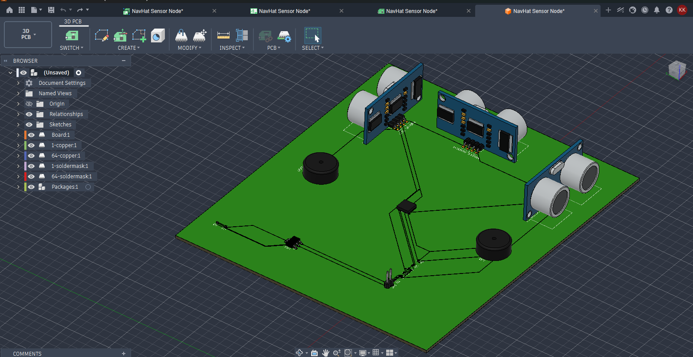

# NavHat PCB Design — Sensor Node

PCB schematic and layout for the NavHat PRO sensor node, designed in 
Autodesk Fusion 360 (Electronics workspace).

## Overview
ESP32-based sensor node with 3x HC-SR04 ultrasonic sensors and 2x 
piezo buzzers for real-time obstacle detection and audio alerts.

## Key Design Decisions
- **5V→3.3V signal protection**: HC-SR04 ECHO pins output 5V logic, 
  but ESP32 GPIOs are 3.3V-tolerant only. Added a resistive voltage 
  divider (1kΩ + 2kΩ) on each ECHO line to safely step down the signal.
- **LD1117-3.3 LDO regulator**: Converts the 5V boost-converter output 
  to a clean 3.3V rail for the ESP32's VDD3P3 pins, with 10µF input/
  output capacitors for stability.
- **Power chain**: LiPo (3.7V) → TP4056 charger → boost converter (5V) 
  → LD1117 (3.3V) → ESP32

## Pin Mapping

| ESP32 Pin | Connects To | Function |
|---|---|---|
| GPIO13 | HC-SR04 Front TRIG | Trigger |
| GPIO18 | HC-SR04 Front ECHO (via divider) | Echo |
| GPIO14 | HC-SR04 Left TRIG | Trigger |
| GPIO33 | HC-SR04 Left ECHO (via divider) | Echo |
| GPIO19 | HC-SR04 Right TRIG | Trigger |
| GPIO23 | HC-SR04 Right ECHO (via divider) | Echo |
| GPIO25 | Buzzer L | PWM tone |
| GPIO4 | Buzzer R | PWM tone |

## Schematic

## PCB Layout

## 3D Render

## Tools
- Autodesk Fusion 360 (Electronics workspace)
- KiCad rebuild — *in progress*

## Status
- [x] Schematic capture + ERC validated
- [x] PCB routing (autoroute, 0 unrouted nets)
- [x] 3D render
- [x] KiCad rebuild
- [x] Gerber export
